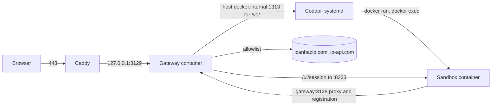

# Hosting the Playground on DigitalOcean

One droplet runs everything: Caddy for TLS, the gateway container, the Codapi server, and the sandbox containers.
Terraform creates the droplet, its firewall, and the DNS record.
Ansible installs and configures everything on it.
The droplet is meant to live for about a week and then be destroyed.



## What You Need Locally

- Terraform 1.5 or newer, Ansible core 2.15 or newer with the `community.docker` and `community.general` collections (`ansible-galaxy collection install -r deploy/ansible/requirements.yml`).
- `sops` and `age`, with your age private key at `~/.config/sops/age/keys.txt` and its public key listed in `.sops.yaml`.
  The DigitalOcean API token lives in `secrets/terraform.sops.env` as `TF_VAR_do_token`; `just sops secrets/terraform.sops.env` edits it.
  Terraform state is committed encrypted as `deploy/terraform/state.sops.json`; every `just infra-*` recipe decrypts it, runs Terraform, and re-encrypts it if it changed.
  See `secrets/README.md` for onboarding another operator.
- An SSH key already uploaded to DigitalOcean whose name is in `ssh_key_names` (`deploy/terraform/variables.tf`).

## First Launch

```bash
just infra-init
just infra-apply
```

Terraform creates the droplet in `sfo3` (`s-4vcpu-8gb-amd`; the plain `s-4vcpu-8gb` is not offered there), a cloud firewall that opens only 22, 80, and 443, the A record `temporal.egger.codes`, and writes `deploy/ansible/inventory/hosts.yml`.
Change any of those with `-var`, for example `just infra-apply -var git_ref=feature/my-branch`, or put overrides in a gitignored `deploy/terraform/*.tfvars` file.
After an apply or destroy, commit `deploy/terraform/state.sops.json`; it is the only copy of the state.

Give the droplet a minute to boot, then:

```bash
just deploy
```

The first run takes 10 to 15 minutes because it builds the gateway, the shared base image, and the four sandbox images on the droplet.
Caddy requests its certificate as soon as it starts, which needs the A record to resolve; DigitalOcean DNS updates within a minute of `terraform apply`.

Check the result:

```bash
just smoke https://temporal.egger.codes
```

Then open <https://temporal.egger.codes/> and walk through one page by hand: run, switch the network off, run again and watch the retries, switch it back on, open the Web UI panel.

## Redeploying

Ansible checks out `playground_git_ref` (default `main`, set in the inventory by Terraform's `git_ref` variable) and rebuilds the images only when the checkout changed or an image is missing.

```bash
just deploy
```

To deploy a branch without changing Terraform's variable:

```bash
just deploy -e playground_git_ref=feature/my-branch
```

A rebuild does not interrupt the running site.
After a new checkout, Codapi restarts because it reads its configuration only at startup, and the gateway container is recreated so its bind mounts of `web/` and `examples/` follow the new checkout (a checkout can delete and recreate those directories, which leaves a running container pointing at dead inodes).

## Where Things Live on the Droplet

| What | Where |
|---|---|
| Repository checkout | `/opt/temporal-playground` |
| Codapi binary, temp dir | `/opt/codapi/codapi`, `/opt/codapi/tmp` |
| Codapi config | `/opt/temporal-playground/codapi` (the repository's own directory) |
| Gateway | `docker compose` project `temporal-playground` from `deploy/compose.yaml`, settings in `/etc/temporal-playground.env` |
| Sandbox network | `temporal-codapi-sandbox`, subnet `10.213.0.0/24`, bridge `br-sandbox`, gateway at `10.213.0.2` |
| Isolation rules | `/usr/local/sbin/sandbox-isolation` (nftables), run by `sandbox-isolation.service` after Docker |
| Caddy | `/etc/caddy/Caddyfile` |

Logs:

```bash
journalctl -u codapi -f
journalctl -u caddy -f
docker logs -f temporal-codapi-gateway
```

`just deploy-ssh` opens a root shell.

## Isolation

Sandboxes share one internal Docker network so they can reach the gateway, which is their only route to the internet and the only place that can reach their Web UI.
Without more rules, one learner's code could reach another learner's Web UI on port 8233, and the Web UI exposes the Temporal API.
`sandbox-isolation` installs two nftables tables: in the `bridge` family, frames that enter and leave on the sandbox bridge are dropped unless one end is the gateway (ARP included), and in the `ip` family, traffic from the bridge to the host itself is dropped, so sandboxes cannot reach Codapi or the Docker API on the host.
The rules live in the bridge family because Docker 28 and later do not load `br_netfilter`, so same-bridge traffic never reaches the iptables `FORWARD` chain where `DOCKER-USER` sits.
Inspect them with `nft list table bridge sandbox_isolation`.

To verify from the droplet, run a sandbox shell on the network and try the neighbors:

```bash
docker run --rm --network temporal-codapi-sandbox temporal-codapi/python:latest \
    bash -c 'curl -s --max-time 3 --noproxy "*" gateway:3128/current/x && echo gateway-ok; \
             curl -s --max-time 3 --noproxy "*" 10.213.0.1:1313/ || echo host-blocked'
```

The gateway also limits runs per client address (`RUN_RATE` and `RUN_BURST` in `/etc/temporal-playground.env`, defaults 20 per minute with a burst of 20) and returns 429 with a message the page shows.
A classroom behind one NAT address shares one bucket; raise the numbers in `deploy/ansible/group_vars/all.yml` before a workshop.

## Cost and Teardown

| Item | Amount |
|---|---|
| `s-4vcpu-8gb-amd` | $56 per month, billed hourly at $0.0833 |
| One week | about $14 |

The droplet keeps billing until it is destroyed.
When the demo is over:

```bash
just infra-destroy
```

That removes the droplet, the firewall, the DNS record, and the generated inventory.
Commit the re-encrypted `deploy/terraform/state.sops.json` afterward.
Nothing on the droplet is state worth keeping; the repository is the source of truth.

Current deployment: launched 2026-10-22 as a test deploy from the deploy branch, moved to `main` on 2026-10-23; planned teardown 2026-10-29.
After the branches merge, `just infra-apply` (default `git_ref=main`) rewrites the inventory and `just deploy` moves the droplet to main without recreating it.
