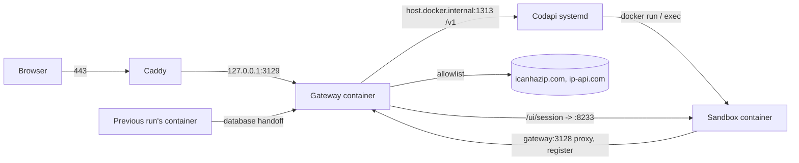

# Temporal Tutorial Playground: Public Deployment

## Starting context

Mason built the playground locally (gateway, four Codapi sandboxes, tutorial pages) and had it running on another machine.
This phase puts it on a DigitalOcean droplet behind HTTPS for about a week of public demo use, with Terraform for the droplet and Ansible for everything on it.
The DigitalOcean account runs on a monthly credit that Mason describes as $200; the deployment must stay inside it.

## Project overview

A browser edition of the learn.temporal.io tutorial "Build a Temporal Application from scratch" for Python, Go, Java, and TypeScript.
Each run gets a throwaway Temporal dev server, Worker, and client inside a Codapi sandbox container.
A Go gateway serves the pages, enforces the egress allowlist, gives each learner a network switch and a Web UI route, and carries each learner's Temporal history from one run's container to the next.
The code is at github.com/MasonEgger/temporal-codeapi-demo (public), all on `main`.

This phase added a `deploy/` tree (Terraform plus Ansible), the code changes the hosted topology needed, and the operating notes to run it for a while and tear it down.
The playground is not running between demos: it comes up on demand with `just infra-apply` and `just deploy` (about 20 minutes, most of it image builds) and comes down with `just infra-destroy`.

### Decisions

| Decision | Choice | Why |
|---|---|---|
| Hostname | `temporal.egger.codes` (variable `hostname` in Terraform, `playground_hostname` in Ansible) | The `egger.codes` zone is already in DigitalOcean DNS, so Terraform owns the A record and Caddy gets a Let's Encrypt cert with no manual step |
| Droplet | `s-4vcpu-8gb-amd` ($56/mo, $0.0833/h), Ubuntu 24.04, region `sfo3` | Java and TypeScript boxes cap at 1.5 GB each, a pool of 4 concurrent runs, plus lingering dev servers and on-box image builds; sfo3 does not offer the plain `s-4vcpu-8gb` |
| Images | Built on the droplet from a git clone at `playground_git_ref` (default `main`) | Public repo, no registry or secrets, same build as the justfile |
| Codapi | v0.14.2 binary under systemd as user `codapi` (Codapi's own install layout) | Needs the docker CLI and bind-mounts a per-run temp dir into each sandbox; a host install keeps those paths simple |
| Reverse proxy | Caddy, one public origin | Automatic TLS; the page, the Codapi API, and the embedded Web UI must share an origin |
| Secrets | sops with age, the convention from PyTexas/infrastructure and Labradillo/infra | No plaintext token on disk, state committed encrypted, one recipient list for every operator |
| Lifetime | On demand: up for a demo, destroyed after | Budget; a full month does not fit the credit headroom |

### Budget

| Item | Amount |
|---|---|
| September 2026 invoice, product charges | $133.00, offset by "DO Alumni Discount (100%)" to $0.00 |
| Standing resources on 2026-10-22: dev ($96), valheim ($32), hosted-tailnet-apps ($24), tailnet-exit-nyc2 ($8), labradillo-prod ($6), Spaces ($5) | $171/mo |
| Headroom under $200 with every standing resource running a full month | $29/mo |
| This droplet | $0.0833/h, about $2 per day or $14 per week |
| Actual: first deployment, 2026-10-22 to 2026-10-30 (October invoice line) | $17.67 |
| Actual: one-day redeploy, 2026-11-02 to 2026-11-03 | about $2 |

doctl shows the discount as a 100% line item, not a $200 cap, so the cap is Mason's knowledge, not something the API confirmed.
`doctl balance get` reads $0.00 under the discount; real spend comes from `doctl invoice get <uuid>` and `doctl compute droplet list`.

## Invariants

- Git: never commit to main; feature branches, signed commits (`git commit -S`), Mason merges.
- Git: Mason squash-merges, so never stack one PR on another's branch; after a base PR lands, replay dependent commits onto `main` instead.
- Git: every commit adds a new `.ai-sessions/` summary file; the global pre-commit hook refuses a commit without one.
- Python: per the `python:python` skill (ruff, mypy strict, pytest, uv).
- Go: `gofmt`, `go vet`, tests next to the code, as in `gateway/`.
- Writing: per `~/.claude/writing-hard-rules.md` (no em dashes, one sentence per line in committed Markdown, Title Case headings outside Temporal docs).
- Diagrams: Mermaid or a themed SVG, never box-drawing characters; render an SVG in both palettes before committing it.
- paths: `web/tutorials/source/` is never edited.
- paths: every code file starts with a two-line `ABOUTME:` header.
- Secrets: the DigitalOcean token is `TF_VAR_do_token` in `secrets/terraform.sops.env`, injected with `sops exec-env`; Terraform state is committed encrypted as `deploy/terraform/state.sops.json` through the justfile's `_tf` wrapper.
  Plaintext state, `.tfvars`, and the generated inventory are gitignored; `.gitleaks.toml` allowlists the ciphertext.
- State: never run `terraform` directly in `deploy/terraform`; go through `just infra-*`.
  Commit `state.sops.json` in the same sitting as every apply or destroy, since the repository is the only copy and an uncommitted change leaves the repository disagreeing with the account about what is billing.
- Sandboxes keep `cap_drop: all`, the internal network, and the proxy-only egress; no deployment change widens what learner code can reach.
- Codapi, Docker, and the gateway's sandbox-facing port never listen on the public interface; only Caddy's 80 and 443 and SSH are open.
- The deployment touches one droplet, one firewall, and one DNS record; nothing else in the DigitalOcean account is managed or modified.

## Available tooling

**MCPs:**
- mcp__temporal-docs__search_temporal_knowledge_sources (only if the dev server's flags or Web UI behavior come up)

**Skills:**
- python:python (smoke tests)
- temporal:temporal-developer (dev server flags, Web UI)

**Verification command:** `just check` locally; `just smoke https://temporal.egger.codes` against the droplet after `just deploy`

**Notes:** Terraform and Ansible have no skill here; validate with `terraform fmt -check`, `terraform validate`, `ansible-lint --offline` (production profile), and `ansible-playbook --syntax-check`.
Gateway tests run in `golang:1.26-bookworm` when the local Go is older than `go.mod` asks for.
Rendered pages and SVGs are checked with headless Chrome (`zenika/alpine-chrome` in Docker, `--dump-dom` or `--screenshot`) since the dev machine has no browser.
The secret scan runs in `just check` (gitleaks) and, opt-in, as `.githooks/pre-commit`.
Locally installed: Terraform 1.15.3, Ansible core 2.21.2 with `community.docker`, `community.general`, `community.digitalocean`, `ansible.posix`, sops 3.13.1, age, doctl (authenticated as mason@masonegger.com).
This machine's SSH key is the DigitalOcean key named `labradillo-dev-box`.

## Roadmap / phase log

**Shipped:**
- hosting-digitalocean: Terraform, Ansible, one-origin gateway, run limit, sandbox isolation, sops secrets; live 2026-10-22 to 2026-10-30 (PRs 3 and 4)
- gateway-recreate: the gateway container is recreated after a checkout change; smoke tests fetch every page (PR 5)
- first-test-and-folded-output: a "Run the Workflow test" button at the tutorial's first test run; sample output and screenshots fold into closed accordions (PR 6)
- session-history: a session's Temporal database follows it across run containers so the Web UI shows every run (PR 7)
- one-day redeploy 2026-11-02 to 2026-11-03 and teardown, state committed (PR 8)

**Upcoming:**
- none; the next deployment is on demand

**Deferred:**
- Image builds in GitHub Actions pushed to GHCR: a fresh droplet spends most of its 20 minutes building images; worth it if redeploys become frequent.
- Per-session Docker networks instead of one shared internal network: Codapi fixes the network per box in `box.json`, so this needs a Codapi change or a wrapper; the nftables rules in G3 cover the exposure.
- Response caching for `/v1/exec` (Codapi's nginx guide): runs are not idempotent here, so caching would be wrong.
- Monitoring and alerting beyond DigitalOcean's built-in droplet graphs: short lifetimes.
- Multiple droplets or a load balancer: out of budget and out of need.
- Backups or snapshots: nothing on the box is state; the repository is the source of truth.
- A higher run limit for workshops behind one NAT address: raise `run_rate`/`run_burst` in `group_vars/all.yml` before the event; no per-event mechanism yet.

## Goals

### G1. One origin for the page, the Codapi API, and the Web UI

Hosted, everything goes through Caddy on 443, so the Codapi API must be reachable on the page's origin.

- The gateway's `-codapi-addr` flag (default empty, meaning off) makes the site handler reverse-proxy `/v1/` to Codapi, forwarding the body unchanged with `Cache-Control: no-store`.
- `web/tutorial.js` defaults to the same-origin `/v1`; the `data-codapi-url` override on `<body>` stays for anyone running Codapi elsewhere.
- `just up` passes `-codapi-addr host.docker.internal:1313` and `--add-host host.docker.internal:host-gateway`, so local development uses the same path as production.
- `tests/test_sandboxes.py` reads `PLAYGROUND_URL` (default `http://localhost:3129`) and always goes through the gateway, so the same suite runs against localhost and the droplet.

### G2. Per-address rate limit on runs

Codapi has no authentication and answers `busy` only when the pool is full, and stock Caddy has no rate limiting, so the gateway does it.

- `/v1/exec` is limited per client address with a token bucket (`-run-rate`, `-run-burst`; the droplet uses 20 per minute with a burst of 20).
  `-trust-proxy` keys on the first `X-Forwarded-For` address, since Caddy sits in front.
- Over the limit returns `429` with a JSON `stderr` that `web/tutorial.js` shows in the run console, which is how the page tells the limit apart from Codapi's own full-pool `429`.

### G3. Learner-to-learner isolation on the sandbox network

Containers on one shared internal network could reach each other's Web UI on port 8233, and the Web UI exposes the Temporal API.

- The sandbox network has a fixed subnet (`10.213.0.0/24`), a fixed bridge name (`br-sandbox`), and the gateway at a fixed IP (`10.213.0.2`).
- An nftables table in the `bridge` family drops frames that enter and leave on `br-sandbox` unless one end is the gateway (ARP included); an `ip` family input rule drops bridge-to-host traffic.
  A systemd oneshot ordered after `docker.service` installs both, so they survive reboots.
- Not iptables: Docker 28 and later do not load `br_netfilter`, so same-bridge traffic never reaches the `FORWARD` chain where `DOCKER-USER` sits.
  The first version used `DOCKER-USER`, installed cleanly, showed zero packet counts, and a sandbox still reached a neighbor; only exercising the blocked path caught it.
- Verified from inside a sandbox: the gateway answers; a neighbor's 8233, ping to a neighbor, and the host's Codapi port do not.

### G4. Terraform for the droplet, firewall, and DNS record

Directory `deploy/terraform/`.

- Provider `digitalocean/digitalocean` (2.x) with `token = var.do_token`, fed `TF_VAR_do_token` by `sops exec-env`; state encrypted in git through `_tf`, which re-encrypts only when the state changed (including after a failed apply).
- Variables with defaults: `region` (`sfo3`), `size` (`s-4vcpu-8gb-amd`), `droplet_name` (`temporal-playground`), `hostname` (`temporal`), `domain` (`egger.codes`), `ssh_key_names` (`["labradillo-dev-box", "Temporal Macbook Pro"]`), `git_ref` (`main`), `tags` (`["temporal-playground"]`).
- Resources: `digitalocean_droplet` (`ubuntu-24-04-x64`, monitoring and IPv6 on, SSH keys looked up by name), `digitalocean_firewall` (inbound 22, 80, 443; all outbound), `digitalocean_record` (A record, TTL 300), and a `local_file` writing the gitignored Ansible inventory with the host, `ansible_user: root`, `playground_hostname`, and `playground_git_ref`.
- Changing `git_ref` replaces only the inventory file, never the droplet.
- Size availability varies by region; check `doctl compute region list --output json` before changing `size` or `region`.

### G5. Ansible for everything on the droplet

Directory `deploy/ansible/` with `ansible.cfg`, `site.yml`, `group_vars/all.yml`, `requirements.yml`, and roles `base`, `docker`, `playground`, `codapi`, `caddy`.
Idempotent: a second run reports zero changes; a run after the checkout moved rebuilds images, recreates the gateway, and restarts Codapi.

- `base`: apt upgrade, `unattended-upgrades`, `fail2ban`, `nftables`, `jq`, `git`, timezone UTC, SSH password and keyboard-interactive auth off.
- `docker`: Docker Engine from Docker's apt repository (not `docker.io`, per Codapi's install guide), `json-file` log rotation, `no-new-privileges`.
- `playground`: `just` from its release tarball with a pinned checksum; the repository at `playground_git_ref`; `just build` when the checkout changed or any image is missing; the sandbox network and isolation oneshot per G3; the gateway from `deploy/compose.yaml` (`restart: unless-stopped`, fixed sandbox IP, `-codapi-addr`, `-trust-proxy`, run limit from `/etc/temporal-playground.env`, read-only mounts of `web/` and `examples/`, port on `127.0.0.1:3129`), recreated whenever the checkout changed; a weekly prune timer for stopped containers and build cache, never images, since the sandbox images sit idle between runs.
- The gateway recreate is required, not cosmetic: a checkout that passes through a commit without `web/` or `examples/` deletes and recreates those directories, and a running container keeps bind mounts to the dead inodes.
  Every page 404'd while `/v1/exec` kept working until the container was recreated.
- `codapi`: user `codapi` in the `docker` group, the release tarball with a pinned checksum, `TMPDIR=/opt/codapi/tmp`, `WorkingDirectory` at the checkout's `codapi/`, restarted by a handler whenever the checkout changed because Codapi reads its config only at startup.
- `caddy`: Caddy from its apt repository, one site block reverse-proxying to `127.0.0.1:3129` with a 1 MB request body limit and no proxy timeout (outage runs take two minutes).

### G6. Operator recipes and docs

- justfile: `infra-init`, `infra-plan`, `infra-apply`, `infra-destroy`, `infra-output` (all through `_tf`), `deploy` (extra arguments pass through, e.g.
  `-e playground_git_ref=<branch>`), `deploy-ssh`, `smoke url`, `sops file`, `rekey`, `install-hooks`.
- `deploy/README.md`: first launch, redeploy, where things live on the droplet, logs, isolation and how to verify it, cost, teardown, and the current deployment's dates.
- `secrets/README.md`: what each encrypted file holds and how to onboard an operator.
- Root README: a "Hosting" section pointing at `deploy/README.md`, the "Exposure" bullet describing the hosted isolation, and the architecture figure as `docs/architecture.svg`.

### G7. Launch and verify

Every deployment, first or on demand, is verified the same way before it is called done:

- `just smoke https://temporal.egger.codes` passes (32 tests: runs, histories, tests, the Workflow-only first test, site pages, session history, concurrency, isolation).
- A multi-run check in one session: each run prints only its own Event History and the Web UI lists every run.
- The outage flow over HTTPS: switch off, run, Temporal retries, switch on, the Workflow completes.
- From inside a sandbox: a neighbor's 8233 is blocked and the gateway answers.
- Teardown recorded in `deploy/README.md` and as a Todoist task with a due time, and the state committed when it runs.

### G8. A session's runs accumulate in one Web UI

Each run starts a fresh Temporal Service in a fresh container, so without help the Web UI panel only ever listed the latest run's Workflow, and repeated runs looked like the same run.
The Workflow IDs were already unique per run; the history was what did not survive.

- `temporal-serve` registers before starting the server.
  The gateway answers `handoff` when the session had a previous container, and the new container waits up to 12 s for that container's database, then starts `temporal server start-dev --db-filename` from it.
- A container that is replaced, or whose 10-minute linger ends, stops its server with SIGTERM (the dev server then leaves one consistent SQLite file) and POSTs the database to the gateway.
- The gateway holds one database per session in memory (32 MiB cap, 15 minutes) and hands it only to the container that replaced the uploader, so a stale upload from two runs back is never used.
- `temporal-run` filters `--history` output by `StartTime`, so the console shows only the current run while the Web UI shows all of them.
- Measured: a database is about 660 KB after one Workflow, arrives about a second after the next container registers, and each later run costs about a second more.

### G9. Tutorial pages match what a learner can run

- The tutorial's first test command comes before the Activity tests exist, so a "Run the Workflow test" button there sends the request without the Activity test file (`data-omit-files`).
- Sample output and Web UI screenshots from the original tutorials are backup for the live console and Web UI panel, so they render in closed accordions; an image the source Markdown runs into a paragraph is lifted into its own accordion, with no change to the tutorial text.

## Non-goals

- Authentication or accounts for learners.
- Persisting anything across gateway restarts: sessions, switches, rate buckets, and handed-over databases live in gateway memory by design.
- Running learner code outside Docker sandboxes, or any sandbox runtime other than `runc`.
- Serving the playground from learn.temporal.io itself or embedding it there in this phase.
- Supporting SDKs beyond Python, Go, Java, and TypeScript in this phase.
- Managing any other DigitalOcean resource in Mason's account.
- Keeping the droplet up between demos.

## Component boundaries

| Component | Inputs | Outputs | Responsibility |
|---|---|---|---|
| Gateway (`gateway/`) | Browser requests on 3129 (from Caddy or localhost); sandbox requests on 3128 | Pages, `/api/sessions`, `/ui/{id}/`, `/v1/` proxied to Codapi, `429` over the run limit, session database handoff | Single origin for the browser; the only route out for sandboxes; a session's history between containers |
| Codapi (host systemd) | `POST /v1/exec` from the gateway on 127.0.0.1:1313 | Container lifecycle via the docker CLI; stdout/stderr JSON | Runs each step in a sandbox from `codapi/` config |
| Sandbox images (`codapi/sandboxes/`) | Learner files at `/sandbox`; `gateway:3128` | Program output; Web UI on 8233 to the gateway only; the session database on exit | One Temporal dev server, Worker, and client per run |
| Caddy | 80 and 443 from the internet | TLS termination, reverse proxy to 127.0.0.1:3129 | The public face; certificates |
| Terraform (`deploy/terraform/`) | `TF_VAR_do_token` from sops, variables, encrypted state | Droplet, firewall, DNS A record, Ansible inventory file | Cloud resources only |
| Ansible (`deploy/ansible/`) | Inventory from Terraform, `group_vars` | A configured droplet running everything above | Everything inside the droplet, idempotently |
| Smoke tests (`tests/`) | `PLAYGROUND_URL` | pytest pass or fail | End-to-end proof against localhost or the droplet |

## Success criteria

- `https://temporal.egger.codes/` and all four tutorial pages load with a valid certificate, and a run completes end to end from a browser that is not on Mason's network.
- The outage demo works over HTTPS: switch off, Activities retry with live lines in the console, switch on, the Workflow completes, the Web UI iframe shows the history.
- Several runs in one session all appear in the Web UI, and each run's console shows only its own history.
- `just smoke https://temporal.egger.codes` passes.
- From inside a sandbox, another sandbox's port 8233 is unreachable while `gateway:3128` is reachable.
- A second `just deploy` reports zero changed tasks; a deploy after the checkout moved rebuilds, recreates the gateway, and every page still serves.
- After a droplet reboot, Caddy, the gateway, Codapi, and the isolation rules come back without manual steps.
- `just infra-destroy` removes the droplet, firewall, and DNS record, the state is committed in the same sitting, and `doctl compute droplet list` no longer shows it.
- Every deployment's cost stays under the credit headroom: about $2 per day at the chosen size.
