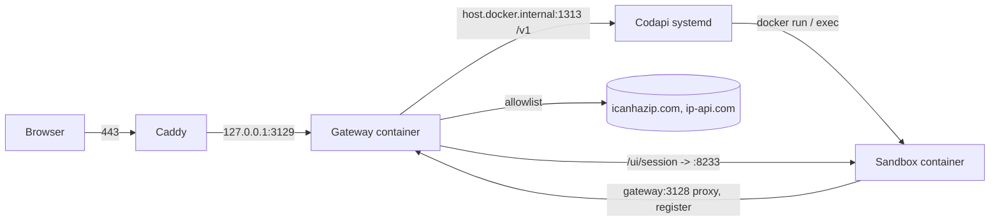

# Temporal Tutorial Playground: Public Deployment

## Starting context

Mason built the playground locally (gateway, four Codapi sandboxes, tutorial pages) and had it running on another machine.
This phase puts it on a DigitalOcean droplet behind HTTPS for about a week of public demo use, with Terraform for the droplet and Ansible for everything on it.
The DigitalOcean account runs on a monthly credit that Mason describes as $200; the deployment must stay inside it.

## Project overview

A browser edition of the learn.temporal.io tutorial "Build a Temporal Application from scratch" for Python, Go, Java, and TypeScript.
Each run gets a throwaway Temporal dev server, Worker, and client inside a Codapi sandbox container.
A Go gateway serves the pages, enforces the egress allowlist, and gives each learner a network switch and a Web UI route.
The code is at github.com/MasonEgger/temporal-codeapi-demo (public); the playground work lives on `feature/codapi-temporal-sandboxes` and is not yet merged to main.

This phase adds a `deploy/` tree (Terraform plus Ansible), the small code changes the hosted topology needs, and the operating notes to run it for a week and tear it down.

### Decisions already made (2026-10-22)

| Decision | Choice | Why |
|---|---|---|
| Hostname | A subdomain of `egger.codes`, default `temporal.egger.codes` (variable `playground_hostname`) | Zone is already in DigitalOcean DNS, so Terraform owns the A record and Caddy gets a Let's Encrypt cert with no manual step |
| Droplet | `s-4vcpu-8gb` ($48/mo, $0.0714/h), Ubuntu 24.04, region `sfo3` (variable) | Java and TypeScript boxes cap at 1.5 GB each, pool of 4 concurrent runs, plus lingering dev servers and on-box image builds |
| Images | Built on the droplet from a git clone at `playground_git_ref` | Public repo, no registry or secrets, same build as the justfile |
| Codapi | v0.14.2 binary under systemd as user `codapi` (Codapi's own install layout) | Needs the docker CLI and bind-mounts a per-run temp dir into each sandbox; host install keeps those paths simple |
| Reverse proxy | Caddy, one public origin | Automatic TLS; the page, the Codapi API, and the embedded Web UI must share an origin |
| Lifetime | About one week, then `terraform destroy` | Budget |

### Budget check (doctl, 2026-10-22)

| Item | Amount |
|---|---|
| September 2026 invoice, product charges | $133.00, offset by "DO Alumni Discount (100%)" to $0.00 |
| Running now: dev ($96), valheim ($32), hosted-tailnet-apps ($24), tailnet-exit-nyc2 ($8), labradillo-prod ($6), Spaces ($5) | $171/mo |
| Headroom under $200 if every current resource runs a full month | $29/mo |
| This droplet, hourly | $0.0714/h, about $12 per week |

One week of `s-4vcpu-8gb` fits.
Two weeks fits.
A full month does not, so the teardown date is part of the deliverable.
doctl shows the discount as a 100% line item, not a $200 cap, so the cap itself is Mason's knowledge, not something the API confirmed.

## Invariants

- Git: never commit to main; feature branches, signed commits (`git commit -S`), Mason merges.
- Python: per the `python:python` skill (ruff, mypy strict, pytest, uv).
- Go: `gofmt`, `go vet`, tests next to the code, as in `gateway/`.
- Writing: per `~/.claude/writing-hard-rules.md` (no em dashes, one sentence per line in committed Markdown, Title Case headings outside Temporal docs).
- paths: `web/tutorials/source/` is never edited.
- paths: every code file starts with a two-line `ABOUTME:` header.
- deps: no Terraform state, inventory, tokens, or `.tfvars` with secrets in git; `deploy/terraform/*.tfstate*`, `deploy/terraform/.terraform/`, and the generated Ansible inventory are gitignored.
- Secrets: the DigitalOcean token comes from the `DIGITALOCEAN_TOKEN` environment variable (doctl already holds one at `~/.config/doctl/config.yaml`); nothing in the repo contains it.
- Sandboxes keep `cap_drop: all`, the internal network, and the proxy-only egress; no deployment change widens what learner code can reach.
- Codapi, Docker, and the gateway's sandbox-facing port never listen on the public interface; only Caddy's 80 and 443 and SSH are open.
- The deployment touches one droplet and one DNS record; nothing else in the DigitalOcean account is managed or modified.

## Available tooling

**MCPs:**
- mcp__temporal-docs__search_temporal_knowledge_sources (only if the dev server's flags or Web UI behavior come up)

**Skills:**
- python:python (smoke tests)
- temporal:temporal-developer (dev server flags, Web UI)

**Verification command:** `just check` locally; `PLAYGROUND_URL=https://<hostname> uv run pytest` against the droplet after `just deploy`

**Notes:** Terraform and Ansible have no skill here; validate with `terraform fmt -check`, `terraform validate`, `ansible-lint`, and `ansible-playbook --syntax-check`. Locally installed: Terraform 1.15.3, Ansible core 2.21.2 with `community.docker` 5.4.0, `community.general` 13.5.0, `community.digitalocean` 1.26.0, `ansible.posix` 2.2.2, doctl (authenticated as mason@masonegger.com). This machine's SSH key is the DigitalOcean key named `labradillo-dev-box` (MD5 65:87:a0:fb:...).

## Roadmap / phase log

**Shipped:**
- none yet (the playground itself shipped in two commits on `feature/codapi-temporal-sandboxes` without a spec)

**Upcoming:**
- Teardown: `just infra-destroy` about one week after launch; the A record goes with it.

**Deferred:**
- Image builds in GitHub Actions pushed to GHCR: only worth it if redeploys become frequent.
- Per-session Docker networks instead of one shared internal network: Codapi fixes the network per box in `box.json`, so this needs a Codapi change or a wrapper; the iptables rule below covers the exposure for now.
- Response caching for `/v1/exec` (Codapi's nginx guide): runs are not idempotent here (fresh dev server each time), so caching would be wrong for this playground.
- Monitoring and alerting beyond DigitalOcean's built-in droplet graphs: one-week lifetime.
- Multiple droplets or a load balancer: out of budget and out of need.
- Backups or snapshots: nothing on the box is state; the repo is the source of truth.

## Goals

### G1. One origin for the page, the Codapi API, and the Web UI

Today `web/tutorial.js` defaults the Codapi URL to `${location.protocol}//${location.hostname}:1313/v1`, a second origin on a second port.
Hosted, everything goes through Caddy on 443, so the API must be reachable on the same origin.

- The gateway gains a `-codapi-addr` flag (default empty, meaning off). When set, the site handler reverse-proxies `/v1/` to it, forwarding the body unchanged and never caching.
- `web/tutorial.js` defaults to the same-origin `/v1`; the `data-codapi-url` override on `<body>` stays for anyone running Codapi elsewhere.
- `just up` passes `-codapi-addr host.docker.internal:1313` and `--add-host=host.docker.internal:host-gateway` so local development uses the same path as production.
- `tests/test_sandboxes.py` reads `PLAYGROUND_URL` (default `http://localhost:3129`) and posts to `${PLAYGROUND_URL}/v1/exec`, so the same suite runs against localhost and the droplet.
- README and CLAUDE.md drop the `:1313` references for the browser; Codapi's port becomes an internal detail.

### G2. Per-IP rate limit on runs

Codapi has no authentication and answers `busy` only when the pool is full.
Stock Caddy has no rate limiting, so the gateway does it.

- The gateway's `/v1/exec` proxy limits requests per client IP (token bucket, defaults 10 per minute with a burst of 5, both flags), trusting `X-Forwarded-For` only when a `-trust-proxy` flag is set because Caddy sits in front.
- Over the limit returns `429` with a JSON body the page can show ("Too many runs from your address; wait a minute").
- `web/tutorial.js` shows that message in the run console instead of a generic error.

### G3. Learner-to-learner isolation on the sandbox network

The README's "Exposure" note: containers on the shared internal network can reach each other's Web UI on port 8233, and the Web UI exposes the Temporal API.

- The sandbox network is created with a fixed subnet and a fixed bridge name (`com.docker.network.bridge.name=br-sandbox`), and the gateway joins it with a fixed IP.
- An iptables rule in the `DOCKER-USER` chain drops bridge-to-bridge traffic on `br-sandbox` except traffic to the gateway's IP. It is installed by a systemd oneshot ordered after `docker.service` so it survives reboots.
- Verification from inside a sandbox: `curl gateway:3128/current/x` answers; `curl <other-container-ip>:8233` fails; `curl <droplet-private-ip>:1313` and the Docker API are unreachable.
- README's "Exposure" bullet is rewritten to describe the hosted setup.

### G4. Terraform for the droplet, firewall, and DNS record

Directory `deploy/terraform/`.

- Provider `digitalocean/digitalocean` (2.x), token from `DIGITALOCEAN_TOKEN`, local state.
- Variables with defaults: `region` (`sfo3`), `size` (`s-4vcpu-8gb`), `hostname` (`temporal`), `domain` (`egger.codes`), `ssh_key_names` (`["labradillo-dev-box", "Temporal Macbook Pro"]`), `git_ref` (`main`), `tags` (`["temporal-playground"]`).
- Resources: `digitalocean_droplet` (image `ubuntu-24-04-x64`, monitoring on, IPv6 on, the named SSH keys looked up by `data.digitalocean_ssh_key`), `digitalocean_firewall` (inbound 22, 80, 443 from anywhere; all outbound), `digitalocean_record` (A record `hostname` in `domain`, TTL 300).
- Outputs: `ipv4`, `fqdn`, and a rendered Ansible inventory written by `local_file` to `deploy/ansible/inventory/hosts.yml` (gitignored) carrying the host, `ansible_user: root`, `playground_hostname`, and `playground_git_ref`.
- `terraform fmt -check` and `terraform validate` pass; `terraform plan` shows exactly three resources plus the local file.

### G5. Ansible for everything on the droplet

Directory `deploy/ansible/` with `ansible.cfg`, `site.yml`, `group_vars/all.yml`, and roles.
Idempotent: a second run reports zero changes; a run with a new `playground_git_ref` rebuilds images and restarts only what changed.

- Role `base`: apt update and upgrade, `unattended-upgrades`, `fail2ban`, `curl`, `git`, `jq`, `just` (Ubuntu 24.04 ships a `just` package; fall back to the upstream install script if the version is too old to parse the justfile), timezone UTC, SSH password auth off.
- Role `docker`: Docker Engine from Docker's apt repository (not `docker.io`, per Codapi's install guide), `daemon.json` with `json-file` log rotation (`max-size` 10m, `max-file` 3) and `no-new-privileges: true`, service enabled.
- Role `codapi`: user `codapi` in the `docker` group with home `/opt/codapi`; download `codapi_0.14.2_linux_amd64.tar.gz` from GitHub releases with a checksum; `/opt/codapi/tmp` as `TMPDIR`; systemd unit from Codapi's `codapi.service` adapted to `WorkingDirectory=/opt/temporal-playground/codapi` and `Environment=TMPDIR=/opt/codapi/tmp`; journald instead of a log file; `Restart=always`.
- Role `playground`: clone the repo to `/opt/temporal-playground` at `playground_git_ref` (`ansible.builtin.git`, `force: yes`); run `just build` only when the checked-out commit changed (register the commit before and after); create the sandbox network per G3 with the fixed subnet and bridge name; install the `DOCKER-USER` oneshot; run the gateway from `deploy/compose.yaml` (`restart: unless-stopped`, fixed IP on the sandbox network, `-codapi-addr` and `-trust-proxy`, read-only mounts of `web/` and `examples/`, port bound to `127.0.0.1:3129`) via `community.docker.docker_compose_v2`; restart Codapi when `codapi/**` changed.
- Role `caddy`: Caddy from its apt repository; `/etc/caddy/Caddyfile` with `{{ playground_hostname }}` reverse-proxying everything to `127.0.0.1:3129`, request body limit 1 MB, access log to journald.
- Housekeeping: a weekly systemd timer running `docker container prune -f` and `docker builder prune -f`. Never `docker image prune -a`: the sandbox images are idle between runs and would be deleted.
- `ansible-lint` and `ansible-playbook --syntax-check` pass.

### G6. Operator recipes and docs

- justfile: `infra-init`, `infra-plan`, `infra-apply`, `infra-destroy`, `deploy` (ansible-playbook with the generated inventory), `deploy-ssh`, and `smoke url` (runs the pytest suite against a URL). Each infra recipe checks that `DIGITALOCEAN_TOKEN` is set and prints how to get it from doctl if not.
- `deploy/README.md`: first launch (apply, wait for DNS, deploy, smoke), redeploy after a code change (`git_ref` or merge to main, then `just deploy`), where logs live (`journalctl -u codapi`, `journalctl -u caddy`, `docker logs temporal-codapi-gateway`), cost and the teardown command, and the one-week teardown date filled in at launch.
- Root README: a short "Hosted at" section pointing at `deploy/README.md`; the "Exposure" bullet rewritten per G3; capacity numbers restated for the droplet.
- CLAUDE.md: the new directory and recipes.

### G7. Launch

- Merge the playground branch to main (Mason), or set `playground_git_ref` to the branch.
- `just infra-apply`, `just deploy`, then `PLAYGROUND_URL=https://temporal.egger.codes uv run pytest` passes all 16 smoke tests.
- Browser check of the full outage flow on each of the four pages over HTTPS: run, switch off, run, watch retries, switch on, Web UI loads in the iframe.
- `doctl balance get` after 24 hours to confirm the hourly charge matches the estimate.
- Teardown date recorded in `deploy/README.md` and, if Mason wants, a Todoist task.

## Non-goals

- Authentication or accounts for learners.
- Persisting anything across runs or across gateway restarts (sessions are in memory by design).
- Running learner code outside Docker sandboxes, or any sandbox runtime other than `runc`.
- Serving the playground from learn.temporal.io itself or embedding it there in this phase.
- Supporting SDKs beyond Python, Go, Java, and TypeScript in this phase.
- Managing any other DigitalOcean resource in Mason's account.

## Component boundaries

| Component | Inputs | Outputs | Responsibility |
|---|---|---|---|
| Gateway (`gateway/`) | Browser requests on 3129 (from Caddy or localhost); sandbox requests on 3128 | Pages, `/api/sessions`, `/ui/{id}/`, proxied `/v1/` to Codapi, `429` over the rate limit | Single origin for the browser; the only route out for sandboxes |
| Codapi (host systemd) | `POST /v1/exec` from the gateway on 127.0.0.1:1313 | Container lifecycle via the docker CLI; stdout/stderr JSON | Runs each step in a sandbox from `codapi/` config |
| Sandbox images (`codapi/sandboxes/`) | Learner files at `/sandbox`; `gateway:3128` | Program output; Web UI on 8233 to the gateway only | One Temporal dev server, Worker, and client per run |
| Caddy | 80 and 443 from the internet | TLS termination, reverse proxy to 127.0.0.1:3129 | The public face; certificates |
| Terraform (`deploy/terraform/`) | `DIGITALOCEAN_TOKEN`, variables | Droplet, firewall, DNS A record, Ansible inventory file | Cloud resources only |
| Ansible (`deploy/ansible/`) | Inventory from Terraform, `group_vars` | A configured droplet running everything above | Everything inside the droplet, idempotently |
| Smoke tests (`tests/`) | `PLAYGROUND_URL` | pytest pass or fail | End-to-end proof against localhost or the droplet |

## Success criteria

- `https://temporal.egger.codes/python.html` (and the other three pages) load with a valid certificate, and a run completes end to end from a browser that is not on Mason's network.
- The outage demo works over HTTPS: switch off, Activities retry with live lines in the console, switch on, the Workflow completes, the Web UI iframe shows the history.
- `PLAYGROUND_URL=https://temporal.egger.codes uv run pytest` passes.
- From inside a sandbox, another sandbox's port 8233 is unreachable while `gateway:3128` is reachable.
- A second `just deploy` reports zero changed tasks; a deploy with a new `git_ref` rebuilds and the site keeps serving during the build.
- After a droplet reboot, Caddy, the gateway, Codapi, and the isolation rule come back without manual steps.
- `just infra-destroy` removes the droplet, firewall, and DNS record, and `doctl compute droplet list` no longer shows it.
- Total DigitalOcean usage for the demo's lifetime stays under the credit headroom (about $12 per week at the chosen size).
